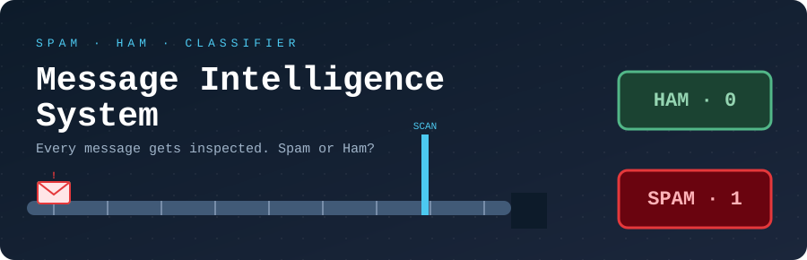

<p align="center">
  
</p>

<p align="center">
  <a href="https://message-intelligence-system-by-master.streamlit.app"><b>🚀 &nbsp;OPEN THE LIVE APP</b></a>
  &nbsp;&nbsp;·&nbsp;&nbsp;
  <a href="https://drive.google.com/file/d/1nS4-JRpopKFmcWSF5RanofXykTJKVV1x/view?usp=drive_link"><b>🎥 &nbsp;WATCH THE PROJECT VIDEO</b></a>
</p>

<p align="center">
  
  
  
  
</p>

---

## 📮 SORTING OFFICE AT A GLANCE

```text
┌────────────────────────────────────────────────────────┐
│   📩  MESSAGE INTELLIGENCE SYSTEM                      │
├────────────────────────────────────────────────────────┤
│   Job       :  Classify messages as Spam or Ham        │
│   Input     :  12 numerical features                   │
│   Output    :  Spam (1)   |   Ham / Legitimate (0)     │
│   Sorters   :  KNN · SVC · Gaussian Naive Bayes        │
│   Interface :  Streamlit web app                       │
└────────────────────────────────────────────────────────┘
```

---

## 🎯 THE MISSION

Compare **distance-based**, **margin-based** and **probabilistic** classification approaches for message spam detection, and let the user pick the model inside an interactive app.

---

## 🤖 THE THREE SORTERS

| Sorter | Approach | How it decides |
|---|---|---|
| 🏘️ **KNN** | Distance-based | Predicts using nearby training examples |
| 🛡️ **SVC (SVM)** | Margin-based | Separates classes using a decision boundary |
| 🎲 **Gaussian Naive Bayes** | Probabilistic | Predicts using class probabilities and the Naive Bayes assumption |

---

## 🔎 THE INSPECTION CHECKLIST (12 Input Features)

| # | Feature | Inspection area |
|:-:|---|---|
| 1 | `message_length` | ✉️ Message content |
| 2 | `word_count` | ✉️ Message content |
| 3 | `num_urls` | ✉️ Message content |
| 4 | `num_digits` | ✉️ Message content |
| 5 | `num_special_chars` | ✉️ Message content |
| 6 | `spam_keyword_score` | 🏷️ Keyword signals |
| 7 | `legit_keyword_score` | 🏷️ Keyword signals |
| 8 | `sender_activity_score` | 👤 Sender behaviour |
| 9 | `sender_account_age_days` | 👤 Sender behaviour |
| 10 | `messages_sent_last_24h` | 👤 Sender behaviour |
| 11 | `hour_of_day` | 🕐 Timing |
| 12 | `day_of_week` | 🕐 Timing |

> ⚠️ The app expects these values **in this exact order and format** used during model training.

---

## 🛤️ THE JOURNEY OF A MESSAGE

```text
  📩 Message arrives
        │
        ▼
  🔢 12 features entered in the Streamlit form
        │
        ▼
  🧠 Chosen model inspects it (KNN / SVC / NB)
        │
        ├──────────► ✅ HAM  (0)  → Legitimate
        │
        └──────────► 🚫 SPAM (1)  → Blocked
```

---

## ✨ WHAT YOU CAN DO

- 🎛️ Select KNN, SVC, or Naive Bayes from the sidebar
- ⌨️ Enter message and sender-behaviour features through a Streamlit form
- 🔮 Predict whether the message is Spam or Ham
- 🏋️ Train and save models using a Jupyter Notebook
- 📏 Evaluate classifiers with accuracy, precision, recall, and F1-score

---

## 📏 QUALITY CONTROL (Evaluation)

Compare the models using:

`Accuracy` · `Precision` · `Recall` · `F1-score` · `Confusion matrix` *(if generated in the notebook)*

📁 Model comparison scores are saved in `outputs/model_scores.csv`.

For a spam detector, always review precision and recall alongside accuracy:

| Mistake | What happens |
|---|---|
| ❌ **False positive** | A legitimate message gets hidden |
| ❌ **False negative** | Spam slips through |

---

## 🗂️ OFFICE LAYOUT (Project Structure)

```text
📦 Message-Intelligence-System/
 ├─ 📁 assets/              README header image
 │   └─ 🎞️ sorting_header.svg
 ├─ 📁 data/                Dataset
 ├─ 📁 model/               Saved classifiers
 │   ├─ 🧠 best_knn.pkl
 │   ├─ 🧠 best_svm.pkl
 │   └─ 🧠 best_nb.pkl
 ├─ 📁 notebook/
 │   └─ 📓 training.ipynb   Training and evaluation
 ├─ 📁 outputs/
 │   └─ 📊 model_scores.csv Model comparison scores
 ├─ 📄 .gitignore
 ├─ 📄 app.py               Streamlit app
 ├─ 📄 requirements.txt
 └─ 📄 README.md
```

> Keep the saved model filenames and the paths in the app consistent. The model files must be in the `model/` directory before launching the app.

---

## ⚙️ OPEN THE OFFICE (Installation & Setup)

**1️⃣ Clone the repository**

```bash
git clone YOUR_GITHUB_REPOSITORY_URL
cd YOUR_PROJECT_FOLDER
```

**2️⃣ Create and activate a virtual environment** *(recommended)*

```bash
# Windows
python -m venv .venv
.venv\Scripts\activate

# macOS / Linux
python3 -m venv .venv
source .venv/bin/activate
```

**3️⃣ Install dependencies**

```bash
python -m pip install --upgrade pip
pip install -r requirements.txt
```

**4️⃣ Check the model files**

Make sure `model/` contains `best_knn.pkl`, `best_svm.pkl` and `best_nb.pkl`. The app loads them at startup.

**5️⃣ Run the app** *(from the project root, where `model/` lives)*

```bash
streamlit run app.py
```

Streamlit will show a local URL, usually `http://localhost:8501`.

---

## 🏋️ TRAINING NOTEBOOK

Open `notebook/training.ipynb` in Jupyter Notebook or VS Code and run the cells in order to prepare data, train and evaluate the classifiers, and save the model files. Update the dataset paths in the notebook to match your local setup.

---

## 🧰 TOOLBOX

`Python` · `Pandas` · `NumPy` · `Scikit-learn` · `Matplotlib` · `Seaborn` · `Joblib` · `Streamlit` · `Jupyter Notebook`

---

## 📝 HOUSE RULES

- Use the **same preprocessing** during training and prediction. If preprocessing is part of a saved scikit-learn pipeline, save and load the complete pipeline.
- Do not commit private data or secrets to the public repository.

---

<p align="center">
  <b>👤 Mayur Makwana</b><br>
  <a href="https://github.com/mayurofficial-tech">github.com/mayurofficial-tech</a>
</p>
